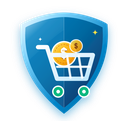
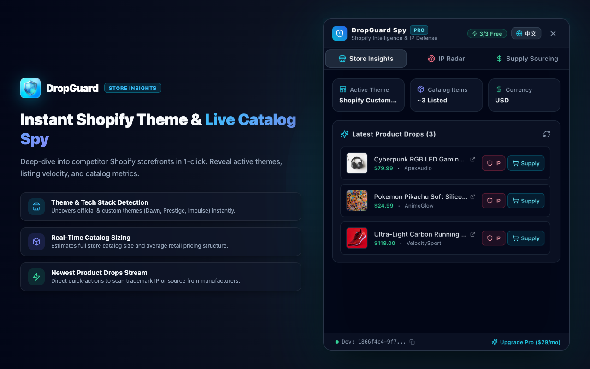
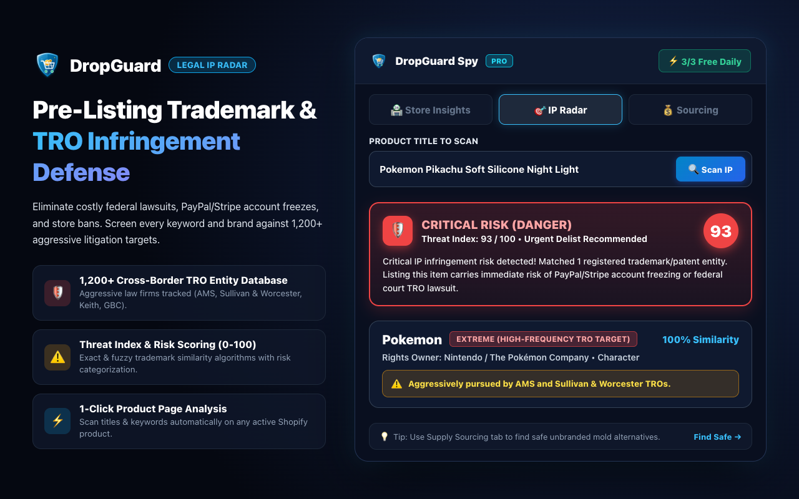
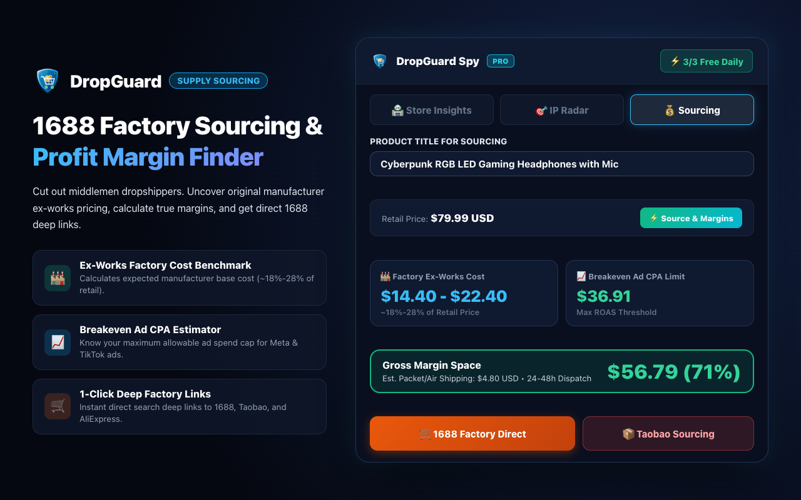

# DropGuard: Shopify Spy & Trademark IP Infringement Radar

  

  <strong>Detect Shopify store insights, uncover trademark IP risks, and estimate 1688 factory sourcing margins in 1 click.</strong>

  
  
  
  

---

## 🌟 Overview

**DropGuard** is a lightweight, privacy-first Chrome Extension engineered specifically for dropshippers, DTC brand builders, and Shopify merchants. 

It acts as an automated defense radar against costly federal court trademark lawsuits (TROs) and PayPal/Stripe account freezes, while providing surgical competitor intelligence on any Shopify storefront.

- 🛒 **Install on Chrome Web Store**: [Get DropGuard](https://chromewebstore.google.com/detail/beonhmmcnpplhahoicndfabcimbbmjkm)
- 🌐 **Official Website**: [https://dropguard.pages.dev/](https://dropguard.pages.dev/)

---

## 🚀 Key Features

### 1. 🛡️ Real-Time Trademark IP Risk Radar
- **Instant Keyword Screening**: Fuzzy-matches product titles against **35+ high-risk trademark, patent, and character databases** (Disney, Apple, Marvel, PopSockets, Crocs, Velcro, etc.).
- **TRO Lawsuit Defense**: Catches deceptive copycat variants and misspellings that commonly trigger Illinois federal court statutory damages or frozen payment gateway balances.
- **Threat Index**: Visual risk gauge scoring products as `SAFE`, `WARNING`, or `CRITICAL RISK`.

### 2. 🏬 Shopify Storefront & Competitor Insights
- **Automatic Theme Detection**: Uncovers active theme templates (Dawn, Impulse, Prestige, etc.) in milliseconds.
- **Catalog Estimation & Latest Drops**: Monitors competitor inventory size and inspects newly released product drops.
- **1-Click Pivot**: Send any product directly into IP defense or sourcing analysis with one click.

### 3. 🏭 1-Click Supply Chain & Factory Margin Spy
- **Ex-Works Factory Cost Prediction**: Automatically calculates realistic factory unit cost brackets (18% - 28% of retail price).
- **Breakeven Ad CPA**: Projects maximum allowable Meta & TikTok advertising cost per acquisition.
- **Direct Sourcing Deep Links**: 1-click deep links directly to **1688** (China direct factory wholesale) and **AliExpress** (global dropshipping fulfillment).

### 4. 🔒 Privacy First & Zero Style Interference
- Injected inside an **isolated Shadow DOM** container to prevent host website CSS conflicts or styling bleed.
- Requires no login credentials or browsing history tracking.

---

## 📸 Screenshots

| Storefront Insights & Theme Spy | IP Infringement Threat Radar | 1688 Factory Sourcing & Margin Calculator |
|:---:|:---:|:---:|
|  |  |  |

---

## 🛠️ Tech Stack

- **Frontend Extension**: React, TypeScript, Tailwind CSS, Lucide Icons, Vite
- **DOM Isolation**: Shadow DOM Web Components
- **Backend API**: Cloudflare Workers, Hono, Cloudflare KV (Global edge latency < 30ms)
- **Deployment**: Cloudflare Pages & Google Chrome Web Store

---

## 🤝 Community & Feedback

We welcome feedback, suggestions, and feature requests from merchants and developers alike!
- Website: [https://dropguard.pages.dev/](https://dropguard.pages.dev/)
- Store: [Chrome Web Store Link](https://chromewebstore.google.com/detail/beonhmmcnpplhahoicndfabcimbbmjkm)
